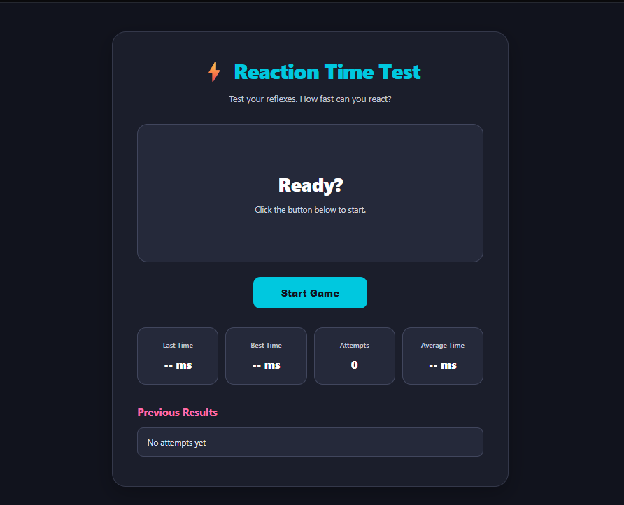
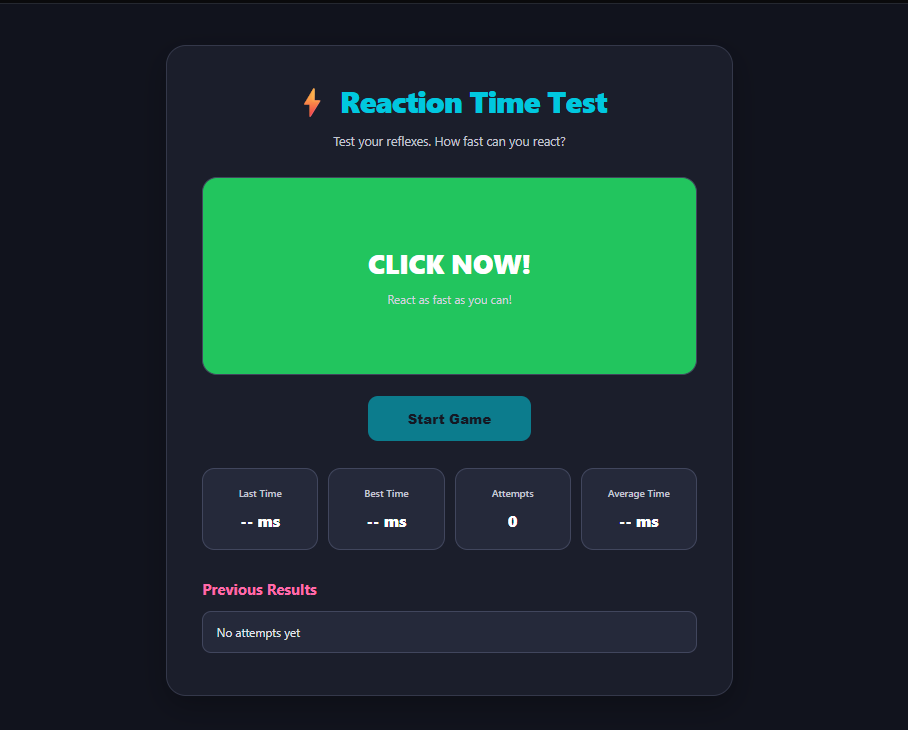
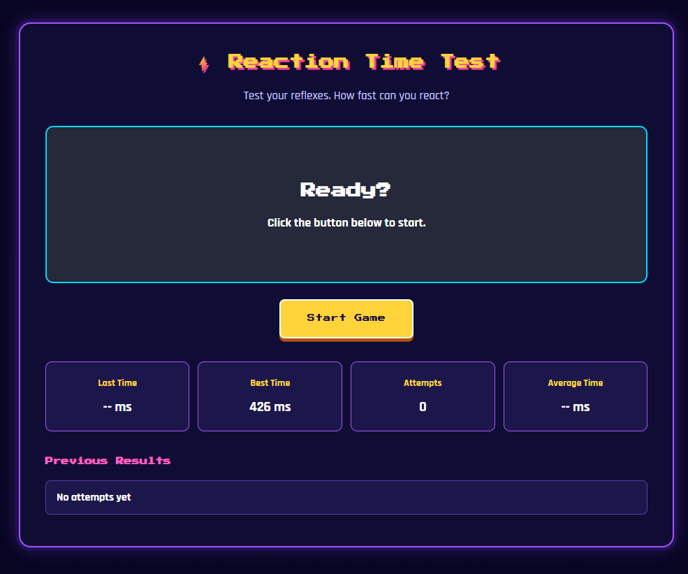
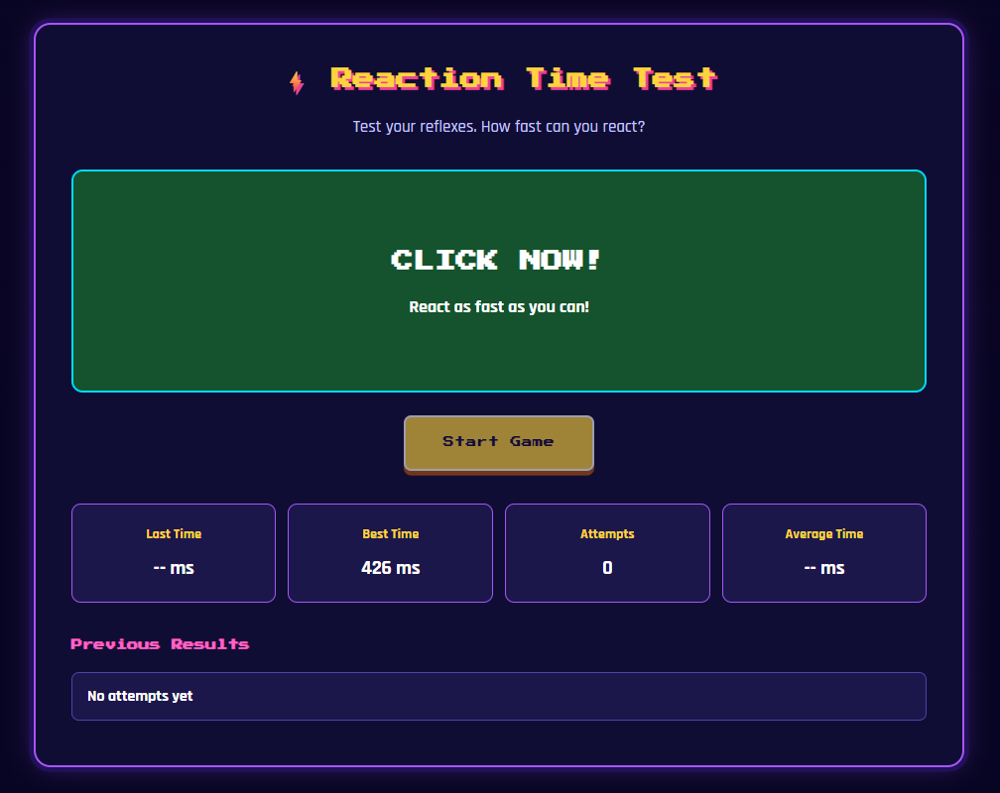

# ⚡ Reaction Time Game

A fun and interactive browser game that tests your reaction speed. Wait for the game screen to change, click as quickly as possible, and see how fast your reflexes are!

## 🌐 Live Demo

**[Play Reaction Time Game](https://rayan-reaction-time-game.netlify.app/)**

## 🎮 How to Play

1. Click the **Start Game** button.
2. Wait for the game screen to change to cyan.
3. As soon as it says **CLICK NOW!**, click the game screen.
4. Your reaction time will be displayed in milliseconds (ms).
5. If you click too early, you'll have to try again.
6. Complete all 5 attempts to see your final results.

## ✨ Features

- Random waiting time to make each round unpredictable.
- Measures reaction speed in milliseconds.
- Tracks your best reaction time.
- Calculates your average reaction time.
- Displays your previous attempts.
- Best-of-5 challenge.
- Responsive design for different screen sizes.

## 🛠️ Technologies Used

- **HTML5** – Game structure.
- **CSS3** – Styling and responsive design.
- **JavaScript** – Game logic, arrays, objects, and conditional statements.

## 📸 Screenshots

### 1. Game Ready Screen

### 2. Waiting Screen

### 3. Click Now Screen

### 4. Game Results Screen

## 🚀 How to Run

1. Download or clone this repository.
2. Open the project folder.
3. Open `index.html` in your web browser.
4. Start playing!

## 👩‍💻 Author

Created as part of the **Gabi School AI Assignment**.

**Live Website:** [Reaction Time Game](https://rayan-reaction-time-game.netlify.app/)

**GitHub Repository:** [Reaction-Time-Game](https://github.com/rayaanrazia9-coder/Reaction-Time-Game)
